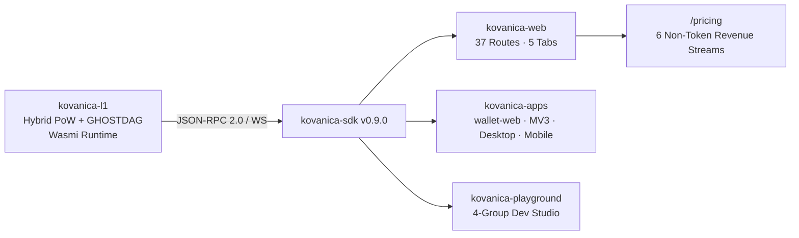

# Kovanica Protocol (KVNC)

![[assets/kovanica-banner.svg]]

> [!IMPORTANT] Start Exploring in 4 Views
> - **Canvases:** [[Kovanica Architecture & Ecosystem.canvas]] · [[Kovanica Business & Revenue Map.canvas]] · [[Kovanica Mainnet 1.1.2027 Roadmap.canvas]]
> - **Color Bubble Graph:** Press `Ctrl+G` (pre-configured with Kovanica Gold / Teal / Blue / Purple / Emerald / Coral clusters)
> - **Pitch Deck Slides:** Open [[Kovanica Pitch Deck (Slides)]] → `Ctrl+P` → **Slides: Start presentation**

  

    
Consensus

    
4s · K=5

    
Hybrid PoW + GHOSTDAG · 0% Stake

  

  

    
Frozen Emission

    
2.5 KVNC

    
8.2M blocks/era · 3/4 burn split

  

  

    
Live Web Portal

    
37 Routes

    
5 Pure Function Tabs · 0 Cookies

  

  

    
Mainnet Genesis

    
1.1.2027

    
Chain 1 · 1-f35df34c92001436

  

---

## Ecosystem Map

  

    <h3>1 · Core Layer-1 (Rust)</h3>
    <ul>
      <li>[[01 - Consensus & L1 Architecture]] — Hybrid PoW + GHOSTDAG & Wasmi</li>
      <li>[[02 - Tokenomics & Frozen Emission]] — Subsidy eras & 3/4 fee burn</li>
      <li>[[03 - PRO-21 Address & Cryptography]] — Ed25519, P-256 & ML-DSA-65</li>
      <li>[[10 - Mining Pool & Stratum V1 TLS]] — Encrypted mining & CLI builder</li>
    </ul>
  

  

    <h3>2 · DeFi, RWA & Client Apps</h3>
    <ul>
      <li>[[04 - Wave A-D Protocol Features]] — Batches, EIP-1559, Passkeys, Bridge</li>
      <li>[[05 - DeFi, AMM & KVP-106 RWA]] — /swap, /pools, /rwa & compliance</li>
      <li>[[08 - Client Applications & Browser Extension]] — wallet-web, MV3, Desktop, Mobile</li>
      <li>[[09 - Developer SDK & Playground]] — kovanica-sdk v0.9.0 & 4-group studio</li>
    </ul>
  

  

    <h3>3 · Web, Revenue & Mainnet</h3>
    <ul>
      <li>[[06 - Five-Repository Ecosystem]] — BetterCallDzuks/* architecture</li>
      <li>[[07 - Web Properties & 5-Tab IA]] — kovanica.online & 5 function tabs</li>
      <li>[[11 - Revenue & Non-Token Monetization]] — 6 streams live on /pricing</li>
      <li>[[12 - Security, Audit & Mainnet 1.1.2027]] — Audit freeze & chain isolation</li>
    </ul>
  

  

    <h3>4 · Strategy, Standards & Brand</h3>
    <ul>
      <li>[[16 - KVP & RFC Standards Registry]] — KVP-20, KVP-101..106 & RFC-001..008</li>
      <li>[[13 - Competitive Positioning (PoW vs PoS vs DAG)]] — PoW vs PoS vs DAG matrix</li>
      <li>[[14 - Developer Quickstart & RPC Cookbook]] — Live curl, SDK & Stratum commands</li>
      <li>[[15 - Visual Brand & Design System]] — Color swatches & typography DNA</li>
      <li>[[Kovanica Mainnet 1.1.2027 Roadmap.canvas]] — 5-phase visual launch timeline</li>
    </ul>
  

---

## Live Architecture Overview

---

## Live Production Endpoints

| Surface | URL | Status |
| :--- | :--- | :--- |
| **Apex Landing** | [kovanica.online](https://kovanica.online) | Live `200` |
| **Testnet Portal** | [testnet.kovanica.online](https://testnet.kovanica.online) | Live `200` |
| **Documentation** | [docs.kovanica.online](https://docs.kovanica.online) | Live `200` |
| **Built-in Playground** | [playground.kovanica.online](https://playground.kovanica.online) | Live `200` |
| **Dashboard** | [dash.kovanica.online](https://dash.kovanica.online) | Live `200` |
| **Pricing & Services** | [testnet.kovanica.online/pricing](https://testnet.kovanica.online/pricing) | Live `200` |
| **Public Testnet RPC** | `https://rpc-testnet.kovanica.online/rpc` | Live `200` (Chain `2`) |
| **GitHub Organization** | [github.com/BetterCallDzuks](https://github.com/BetterCallDzuks) | 6 Public Repos |
