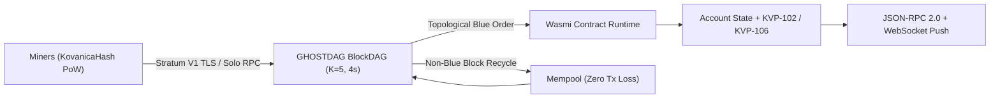

# 01 · Consensus & L1 Architecture

Back to [[00 - Kovanica Protocol MOC]] · See [[Kovanica Architecture & Ecosystem.canvas]]

## Hybrid PoW + GHOSTDAG Consensus

Kovanica (`kovanica-l1`) is built from scratch in Rust to run reliably on modest 2–4 GB RAM virtual servers while delivering fast BlockDAG confirmation:

- **Zero Stake on Consensus:** No validators, no validator committee, and no staking cartels on Mainnet (Chain `1`) or Testnet (Chain `2`). Legacy staking calls are rejected fail-closed (`-32600 InvalidRequest`).
- **KovanicaHash PoW:** BLAKE3 + 2 MiB memory mix designed for fair, accessible mining (see [[10 - Mining Pool & Stratum V1 TLS]]).
- **GHOSTDAG (`K=5`):** `4,000 ms` (`4s`) target block interval with topological sub-DAG ordering. Non-blue blocks are safely recycled to the mempool with **zero transaction loss**.
- **Deterministic Wasmi Runtime:** Account-based ledger hosting sandboxed WebAssembly smart contracts for native DeFi, KVP-102 tokens, and KVP-106 RWA (see [[05 - DeFi, AMM & KVP-106 RWA]]).

## Related Notes
- [[02 - Tokenomics & Frozen Emission]]
- [[03 - PRO-21 Address & Cryptography]]
- [[04 - Wave A-D Protocol Features]]
- [[10 - Mining Pool & Stratum V1 TLS]]
- [[12 - Security, Audit & Mainnet 1.1.2027]]
