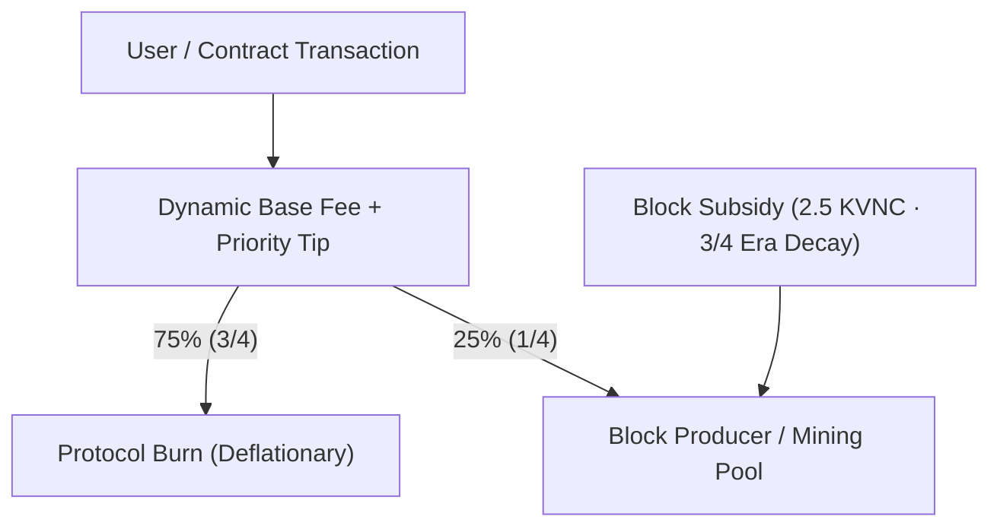

# 02 · Tokenomics & Frozen Emission

Back to [[00 - Kovanica Protocol MOC]]

![[assets/emission-curve.svg]]

> [!IMPORTANT] Audit-Frozen Economic Parameters
> All emission and fee-split constants below are locked in `kovanica-l1` for Mainnet (`1.1.2027`).

## Core Monetary Parameters

| Parameter | Frozen Value |
| :--- | :--- |
| **Native Coin** | **KVNC** (`9` decimals · `1 KVNC = 1,000,000,000 atoms`) |
| **Initial Block Reward** | `2.5 KVNC` |
| **Subsidy Era Length** | `8,200,000` blocks (~1.04 years at `4s` blocks) |
| **Era Decay Factor** | `3/4` geometric decay per era |
| **Transaction Fee Split** | **`3/4` burned** · **`1/4` miner reward** |
| **Fee Market (Wave B)** | EIP-1559 dynamic base fee + per-byte storage deposit |

## Fee & Value Flow

## Related Notes
- [[01 - Consensus & L1 Architecture]]
- [[04 - Wave A-D Protocol Features]]
- [[10 - Mining Pool & Stratum V1 TLS]]
- [[11 - Revenue & Non-Token Monetization]]
