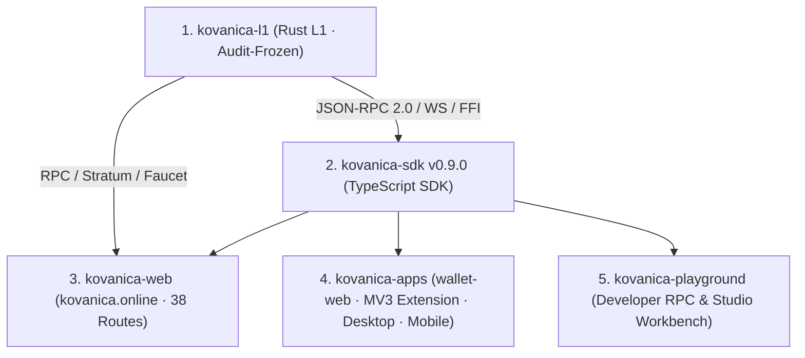

# 06 · Five-Repository Ecosystem

Back to [[00 - Kovanica Protocol MOC]] · See [[Kovanica Architecture & Ecosystem.canvas]]

All five repositories under **`BetterCallDzuks/*`** enforce a strict PR-only workflow against `main` (`pr-policy.yml`) with clean separation of concerns:

| Repository | Stack | Role |
| :--- | :--- | :--- |
| **`BetterCallDzuks/kovanica-l1`** | Rust | Layer-1 node, Hybrid PoW + GHOSTDAG, Wasmi, RPC, Stratum, Faucet, Indexer, CLI |
| **`BetterCallDzuks/kovanica-sdk`** | TypeScript (`v0.9.0`) | Browser/Node client, failover transport, Wave A–D facades, offline codecs |
| **`BetterCallDzuks/kovanica-web`** | TanStack Start + Nitro + Tailwind v4 | Public portal (`kovanica.online`), Explorer, AMM, RWA, Mining Pool, Docs, Pricing |
| **`BetterCallDzuks/kovanica-apps`** | React, Tauri, MV3, Kotlin, Swift | `wallet-web`, `browser-extension`, `console-desktop`, `node-desktop`, Android, iOS |
| **`BetterCallDzuks/kovanica-playground`** | React 18 + Vite 5 | Read-only RPC Explorer + 4-group developer studio workbench |

## Related Notes
- [[07 - Web Properties & 5-Tab IA]]
- [[08 - Client Applications & Browser Extension]]
- [[09 - Developer SDK & Playground]]
- [[12 - Security, Audit & Mainnet 1.1.2027]]
