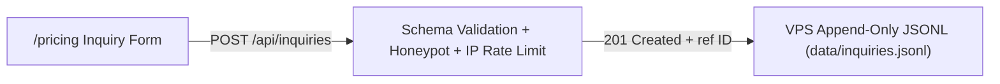

# 11 · Revenue & Non-Token Monetization

Back to [[00 - Kovanica Protocol MOC]] · Live at [testnet.kovanica.online/pricing](https://testnet.kovanica.online/pricing)

> [!TIP] Privacy-First Philosophy
> **Zero tracking cookies and zero third-party ad networks.** Every revenue stream below is built directly into Kovanica's infrastructure and B2B services — independent of KVNC token price.

## All 6 Non-Token Revenue Streams

| # | Stream | Pricing / Model | Live Implementation |
| :-: | :--- | :--- | :--- |
| **1** | **Managed RPC, WS & Indexer SaaS** | Free Public · Builder `$49/mo` · Scale `$249/mo` · Dedicated SLA | `/pricing` + `POST /api/inquiries` |
| **2** | **RWA Issuer & Compliance SaaS** | Issuer Launch `$299/mo` · Institutional `$999/mo` · White-Label | `/pricing`, `/wallet/rwa-issue`, `/wallet/rwa-manage` |
| **3** | **Front-End Swap / Bridge Fee** | `0.00%` on testnet · configurable `0..100` bps for mainnet (`VITE_SWAP_INTERFACE_FEE_BPS`) | Transparent row on `/swap` + `/pricing` |
| **4** | **Official Stratum Mining Pool Fee** | `0%` testnet · `1.0%` planned mainnet (`VITE_MINING_POOL_FEE_PCT`) | Transparent badge on `/pool` + `/pricing` |
| **5** | **Verified Listings & Zero-Cookie Sponsorships** | Token Verification `$250` · RWA Issuer Badge `$500` · Static Sponsor `$400/mo` + optional `https://` partner links | `<SponsorSlot>` on `/faucet`, `/docs`, `/pricing` (`VITE_SPONSOR_*`, `VITE_PARTNER_*`) |
| **6** | **Exchange & Enterprise Support** | Exchange Integration (`$2.5k+`) · Custom Indexer (`$1.5k+`) · SDK Advisory | `/pricing` + `POST /api/inquiries` |

## Lead Intake Architecture (`POST /api/inquiries`)

## Related Notes
- [[02 - Tokenomics & Frozen Emission]]
- [[05 - DeFi, AMM & KVP-106 RWA]]
- [[07 - Web Properties & 5-Tab IA]]
- [[10 - Mining Pool & Stratum V1 TLS]]
